# TicketFlow — Movie & Event Booking Platform

> A full-stack, distributed microservices platform inspired by **BookMyShow** and **District**. Engineered for extreme concurrency, distributed transaction safety, sub-millisecond seat allocation, and zero double-booking tolerance.

---

## 🏛️ System Architecture

```mermaid
graph TD
    %% Client & Edge Layer
    Client[React 19 Frontend] -->|JWT / HTTPS| Gateway[Spring Cloud API Gateway]

    %% Edge Layer
    subgraph Edge_Layer ["Edge Layer"]
        Gateway
        RedisRL[Redis Rate Limiter]
        Gateway -.->|Rate Limit Check| RedisRL
    end

    %% Core Services
    subgraph Spring_Boot_Microservices ["Spring Boot Microservices"]
        Auth[Auth / User Service]
        Catalog[Catalog Service]
        Booking[Booking Service]
        Payment[Payment Service]
        Notify[Notification Service]
    end

    Gateway -->|Authentication| Auth
    Gateway -->|Browse Movies & Events| Catalog
    Gateway -->|Reserve Seats| Booking
    Gateway -->|Payment APIs| Payment

    %% Booking Allocation
    subgraph Seat_Allocation ["Seat Allocation Engine"]
        ST[In-Memory Segment Tree]
        RedisLock[Redis Atomic Seat Locks]
        Booking -->|1. Find Contiguous Seats| ST
        ST -->|2. Candidate Seat Block| RedisLock
        RedisLock -->|3. Atomic Reservation with TTL| Booking
    end

    %% Data Layer
    subgraph Data_Infrastructure ["Data Infrastructure"]
        Redis[Redis Cache]
        DB_Catalog[(Catalog PostgreSQL)]
        DB_Booking[(Booking PostgreSQL)]
        DB_Payment[(Payment PostgreSQL)]
        DB_Notify[(Notification PostgreSQL)]
        Broker[RabbitMQ Event Bus]
    end

    %% Catalog Flow
    Catalog -->|Cache Read / Write| Redis
    Catalog -->|Persistent Data| DB_Catalog

    %% Booking Flow
    Booking -->|4. Create PENDING Booking| DB_Booking
    Booking -->|5. Save Event in Outbox| DB_Booking
    Booking -->|6. Outbox Publisher| Broker

    %% Payment Saga
    Broker -->|CheckoutPending| Payment
    Payment -->|7. Initiate Payment| DB_Payment
    Payment -->|8. Payment Result Event| Broker

    %% Booking Confirmation / Compensation
    Broker -->|PaymentSuccess / PaymentFailed| Booking
    Booking -->|9a. Confirm Booking| DB_Booking
    Booking -->|9b. Release Seat Locks| RedisLock
    Booking -->|10. Update Seat Availability| ST

    %% Notification
    Broker -->|PaymentSuccess / BookingConfirmed| Notify
    Notify -->|Notification Logs| DB_Notify
    Notify -->|Email / SMS Confirmation| User[User]

    %% Seat Expiry
    Expiry[Reservation Expiry Worker]
    RedisLock -.->|TTL Expiry| Expiry
    Expiry -->|Release Expired Holds| Booking

    %% Styles
    classDef service fill:#1e293b,stroke:#3b82f6,color:#93c5fd,stroke-width:2px
    classDef infra fill:#0f291e,stroke:#10b981,color:#6ee7b7,stroke-width:2px
    classDef algo fill:#2d1b06,stroke:#f59e0b,color:#fcd34d,stroke-width:2px
    classDef client fill:#31102f,stroke:#ec4899,color:#fbcfe8,stroke-width:2px

    class Client,User client
    class Auth,Catalog,Booking,Payment,Notify,Gateway service
    class Redis,RedisRL,RedisLock,Broker,DB_Catalog,DB_Booking,DB_Payment,DB_Notify,Expiry infra
    class ST algo
```



---

## 🔄 End-to-End Workflow & Lifecycle

The TicketFlow architecture coordinates high-velocity traffic through a 10-step distributed pipeline:

```
[User Request]
       │
       ▼
 1. Edge Layer: Spring Cloud Gateway authenticates JWT & checks Redis Rate Limiter
       │
       ▼
 2. Contiguous Seat Search: In-Memory Segment Tree queries optimal continuous seat blocks in O(log N)
       │
       ▼
 3. Distributed Lock Acquisition: Atomic Redis lock multi-seat hold with 10-minute TTL (NX PX)
       │
       ▼
 4. Pending Booking State: Persist Booking record (PAYMENT_PENDING) in Booking PostgreSQL
       │
       ▼
 5. Transactional Outbox: Persist domain event in local Outbox table in the same DB transaction
       │
       ▼
 6. Event Dispatch: Background Outbox Publisher pushes CheckoutPending to RabbitMQ Event Bus
       │
       ▼
 7. Payment Saga Step: Payment Service consumes event, records transaction, contacts payment provider
       │
       ▼
 8. Payment Outcome Event: Payment Service emits PaymentSuccess or PaymentFailed to RabbitMQ
       │
       ├─────────────────────────────────┬─────────────────────────────────┐
       ▼                                 ▼                                 ▼
 [On PaymentSuccess]               [On PaymentFailed]              [On TTL Expiration]
 9a. Mark Booking CONFIRMED        9a. Mark Booking CANCELLED      • Expiry Worker triggers
 9b. Mark Seats BOOKED in DB       9b. Compensate: Delete locks    • Releases Redis locks
 9c. Delete Redis temporary lock   9c. Restore Segment Tree        • Marks Booking EXPIRED
 10. Update Segment Tree cache     10. Discard pending cart        • Free seats to pool
       │
       ▼
 11. Async Notification: Notification Service consumes BookingConfirmed, generates QR ticket,
     logs transaction, and dispatches Email & SMS to user
```

---

## 💡 Core Backend Engineering Highlights

### 1. In-Memory Segment Tree Contiguous Seat Allocation ($O(\log N)$)
* **Challenge**: Moviegoers frequently book seats in groups (2 to 6 people) and require consecutive seats in the same row without gaps. Traditional relational database linear queries (`ORDER BY col_index`) create database contention and high CPU overhead under flash-sale spikes.
* **Implementation** ([`SegmentTree.java`](file:///c:/yash/TicketFlow/backend/booking-service/src/main/java/com/ticketflow/booking/algorithm/SegmentTree.java)):
  * Each row of a cinema screen is modeled as an array where `1 = Available`, `0 = Booked / Locked`.
  * Every node in the Segment Tree maintains:
    * `maxContiguous`: Longest contiguous block of free seats in the subtree.
    * `prefixContiguous`: Available seats starting from the left boundary.
    * `suffixContiguous`: Available seats extending to the right boundary.
    * `startIndex`: Zero-indexed starting position of the optimal block.
  * Queries locate contiguous groups crossing subtree boundaries in $O(\log N)$ time. Point updates when seats are locked or confirmed occur in $O(\log N)$.

### 2. Redis-Based Atomic Distributed Seat Locking
* **Challenge**: Preventing double-booking when thousands of users click on identical high-demand seats simultaneously.
* **Implementation** ([`RedisSeatLockService.java`](file:///c:/yash/TicketFlow/backend/booking-service/src/main/java/com/ticketflow/booking/redis/RedisSeatLockService.java)):
  * Key schema: `lock:show:{showId}:seat:{seatId}`
  * Value: `{userId}|{lockUUID}` with 10-minute TTL (`600s`).
  * **All-or-Nothing Rollback**: When a user selects multiple seats (e.g., A1, A2, A3), locks are acquired sequentially. If any seat is already locked by another user, all locks acquired during that request are immediately rolled back, preventing orphaned partial reservations.

### 3. Saga Pattern for Distributed Transactions
* **Challenge**: Coordinating multi-service operations (Seat Locking in Redis $\rightarrow$ Booking Creation in Postgres $\rightarrow$ Payment Execution $\rightarrow$ Seat Confirmation) without blocking two-phase commits (2PC).
* **Implementation** ([`SagaCoordinatorService.java`](file:///c:/yash/TicketFlow/backend/booking-service/src/main/java/com/ticketflow/booking/saga/SagaCoordinatorService.java)):
  * **Forward Path**: `SEATS_LOCKED` $\rightarrow$ `PAYMENT_PENDING` $\rightarrow$ `CONFIRMED` $\rightarrow$ `BOOKED`.
  * **Compensating Path**: If payment fails, times out, or the user cancels, the coordinator executes compensating operations: updates status to `CANCELLED`, deletes Redis locks, and restores the Segment Tree.

### 4. Transactional Outbox Pattern & RabbitMQ Event Bus
* **Challenge**: Guaranteeing consistency between database state changes and asynchronous message publishing (dual-write problem).
* **Implementation**: Domain events are persisted into the local PostgreSQL database in the same transaction as the booking entity. A dedicated publisher forwards them to the RabbitMQ Topic Exchange (`ticketflow.topic.exchange`), guaranteeing at-least-once message delivery to downstream consumers (Payment & Notification services).

### 5. Automated Seat Expiry Worker
* Background scheduled daemon tracking temporary reservations. If the user fails to complete checkout before the 10-minute Redis TTL expires, the reservation is automatically marked `EXPIRED`, releasing hold on seats.

---

## 💻 Tech Stack Matrix

| Layer | Technologies |
|---|---|
| **Frontend** | React 19 / TypeScript, Redux Toolkit, shadcn/ui, Tailwind CSS, Lucide Icons, Vite |
| **API Gateway** | Spring Cloud Gateway, Reactive WebFlux, Redis Rate Limiter, CORS |
| **Service Discovery** | Netflix Eureka Server (`service-registry`) |
| **Backend Microservices** | Spring Boot 3.2.5, Java 17 / 20, Spring Data JPA, Spring AMQP, DevTools |
| **Data Storage** | PostgreSQL 16 (Multi-DB schema isolation), Redis 7 (Distributed Locking & Cache) |
| **Message Broker** | RabbitMQ 3.13 (Topic Exchange, Dead-Letter Queues, Management Web UI) |
| **Infrastructure** | Docker, Docker Compose, PowerShell Orchestration Scripts |

---

## 📁 Repository Directory Structure

```
TicketFlow/
├── backend/
│   ├── pom.xml                               # Parent Maven POM (Spring Boot 3.2.5, Cloud 2023.0.1)
│   ├── shared-dto/                           # DTOs, Enums & RabbitMQ Domain Events
│   ├── service-registry/                     # Eureka Service Discovery Server (Port 8761)
│   ├── api-gateway/                          # Spring Cloud Gateway & Redis Rate Limiter (Port 8080)
│   ├── catalog-service/                      # Movies, Events, Theatres, Screens & Shows (Port 8081)
│   ├── booking-service/                      # Segment Tree, Redis Locks, Saga & Outbox (Port 8082)
│   ├── payment-service/                      # Payment Transactions & Compensation (Port 8083)
│   └── notification-service/                 # RabbitMQ Consumer & E-Ticket Generator (Port 8084)
│
├── frontend/                                 # React + TypeScript + Redux Toolkit + shadcn/ui
│   ├── src/
│   │   ├── api/client.ts                     # Axios Gateway client with fallback mock data
│   │   ├── components/
│   │   │   ├── ui/                           # shadcn/ui Primitives (button, badge, card, dialog, separator)
│   │   │   ├── Navbar.tsx                    # Header, City selector & My Tickets badge
│   │   │   ├── SeatMap.tsx                   # Interactive cinema layout, screen glow & live statuses
│   │   │   ├── ContiguousSeatPicker.tsx      # Segment Tree UI allocator widget (O(log N))
│   │   │   ├── LockCountdownTimer.tsx        # 10-minute Redis lock countdown timer
│   │   │   ├── CheckoutModal.tsx             # Saga payment modal with test failure simulation
│   │   │   ├── TicketConfirmation.tsx        # Confetti celebration & printable digital QR pass
│   │   │   ├── HomePage.tsx                  # Trending movies carousel & live events
│   │   │   ├── MovieDetailPage.tsx           # Movie synopsis, trailer & showtimes
│   │   │   ├── SeatBookingPage.tsx           # Cinema hall view with bottom summary checkout bar
│   │   │   └── MyBookingsPage.tsx            # User booking history & printable passes
│   │   ├── store/                            # Redux Toolkit
│   │   │   ├── index.ts                      # Store configuration & RootState
│   │   │   ├── hooks.ts                      # Typed useAppDispatch & useAppSelector
│   │   │   └── slices/                       # citySlice, bookingSlice, catalogSlice
│   │   ├── types/models.ts                   # TypeScript interfaces (Movie, Show, Seat, Booking)
│   │   ├── lib/utils.ts                      # shadcn cn() class merger
│   │   ├── App.tsx                           # Main router & layout
│   │   └── main.tsx                          # Root React Provider wrapper
│   ├── tsconfig.json                         # TypeScript configuration with @/ path aliases
│   ├── tailwind.config.js                    # Custom cinema themes & animations
│   └── vite.config.ts                        # Port 3000 with /api proxy to Gateway
│
├── docker/                                   # Containerization
│   ├── docker-compose.yml                    # PostgreSQL 16, Redis 7, RabbitMQ 3 Management
│   └── postgres/init.sql                     # Multi-database isolation scripts
│
├── scripts/                                  # Orchestration Scripts
│   ├── start-infra.bat                       # Starts Postgres, Redis, RabbitMQ in Docker
│   ├── build-all.bat                         # Maven multi-module package runner
│   └── run-frontend.bat                      # Starts React Vite dev server
└── README.md
```

---

## 📡 REST API Reference

### 🎬 Catalog Service (`/api/catalog`)
| Method | Endpoint | Description |
|---|---|---|
| `GET` | `/api/catalog/movies` | List all available movies |
| `GET` | `/api/catalog/movies/trending` | List trending movies in the selected region |
| `GET` | `/api/catalog/movies/{id}` | Detailed movie synopsis, rating, duration, and trailer |
| `GET` | `/api/catalog/events` | List featured concerts and comedy events |
| `GET` | `/api/catalog/theatres?city={city}` | Cinema halls located in a given metropolitan city |
| `GET` | `/api/catalog/shows?movieId={id}&city={city}` | Available showtimes, screens, and sound formats |

### 🎟️ Booking Service (`/api/bookings`)
| Method | Endpoint | Description |
|---|---|---|
| `GET` | `/api/bookings/shows/{showId}/seats` | Real-time seat matrix merging DB state with active Redis locks |
| `POST` | `/api/bookings/lock-seats` | Acquire atomic Redis distributed lock on seats (10m TTL) |
| `POST` | `/api/bookings/unlock-seats` | Explicit manual release of temporary seat lock |
| `POST` | `/api/bookings/auto-allocate` | **Segment Tree contiguous $K$-seat allocation ($O(\log N)$)** |
| `POST` | `/api/bookings/initiate` | **Saga Step 1 & 2**: Create pending booking (`PAYMENT_PENDING`) |
| `POST` | `/api/bookings/{id}/confirm` | **Saga Step 4**: Confirm booking, mark seats `BOOKED`, issue QR token |
| `POST` | `/api/bookings/{id}/cancel` | **Saga Step 5**: Compensate / rollback on payment failure |
| `GET` | `/api/bookings/user/{userId}` | Retrieve booking history for a user |

### 💳 Payment Service (`/api/payments`)
| Method | Endpoint | Description |
|---|---|---|
| `POST` | `/api/payments/process` | Process transaction with `idempotencyKey` and Saga coordination |
| `GET` | `/api/payments/{transactionId}` | Fetch status and gateway reference for a transaction |
| `GET` | `/api/payments/booking/{bookingId}` | Fetch payment transaction for a booking |

### 🔔 Notification Service (`/api/notifications`)
| Method | Endpoint | Description |
|---|---|---|
| `GET` | `/api/notifications/booking/{ref}` | Fetch sent email & SMS dispatch logs for a booking |

---

## ⚡ Quick Start & Execution Guide

### 1. Start Infrastructure via Docker
Ensure Docker Desktop is running, then execute:
```cmd
cd scripts
.\start-infra.bat
```
This spins up:
* **PostgreSQL 16** (`localhost:5432`) with isolated databases:
  * `ticketflow_catalog`
  * `ticketflow_booking`
  * `ticketflow_payment`
  * `ticketflow_notification`
* **Redis 7** (`localhost:6379`) for distributed seat locking and rate limiting
* **RabbitMQ 3.13** (`localhost:5672`, Management UI at **[http://localhost:15672](http://localhost:15672)** with `guest`/`guest`)

---

### 2. Run Backend Microservices
From `c:\yash\TicketFlow\backend`, build all modules:
```powershell
cd backend
mvn clean install -DskipTests
```

Start the services in the following order (in separate terminal tabs):

1. **Service Registry (Eureka)**:
   ```powershell
   mvn spring-boot:run -pl service-registry
   ```
   *Dashboard available at: [http://localhost:8761](http://localhost:8761)*

2. **API Gateway**:
   ```powershell
   mvn spring-boot:run -pl api-gateway
   ```
   *Health endpoint: [http://localhost:8080/actuator/health](http://localhost:8080/actuator/health)*

3. **Core Services**:
   ```powershell
   mvn spring-boot:run -pl catalog-service
   mvn spring-boot:run -pl booking-service
   mvn spring-boot:run -pl payment-service
   mvn spring-boot:run -pl notification-service
   ```

---

### 3. Run Frontend Application
From `c:\yash\TicketFlow\frontend`:
```powershell
cd frontend
npm run dev
```
Open **[http://localhost:3000](http://localhost:3000)** in your browser.

---

## 🧪 Interactive Features to Try

1. **City Selection**: Switch between *Mumbai*, *Delhi-NCR*, *Bengaluru*, *Hyderabad* to view local cinemas and showtimes.
2. **Segment Tree Contiguous Seat Selector**:
   * Open any show (e.g., *Dune: Part Two* at PVR IMAX).
   * In the **Segment Tree Contiguous Allocation** widget, choose seat count (e.g. `3`) and preferred tier (`GOLD`).
   * Click **Find Contiguous Seats**: The $O(\log N)$ Segment Tree algorithm will instantly locate 3 adjacent seats without gaps and highlight them on the interactive seating grid.
3. **10-Minute Redis Lock Countdown**:
   * Watch the real-time countdown timer tracking Redis lock TTL.
   * Lock turns amber across users, preventing double-bookings.
4. **Saga Rollback Testing**:
   * In the checkout modal, check **"Test Saga Rollback (Simulate Payment Failure)"**.
   * Click **Pay**: The payment service will simulate a decline, triggering the Saga compensating transaction to cancel the booking and release all Redis seat locks.
5. **Digital Pass & QR Ticket**:
   * Complete a successful checkout to trigger the celebratory confetti explosion, inspect your generated QR ticket, and download or print your admission pass.

---

## 📄 License
This project is open-source and available under the [MIT License](LICENSE).
