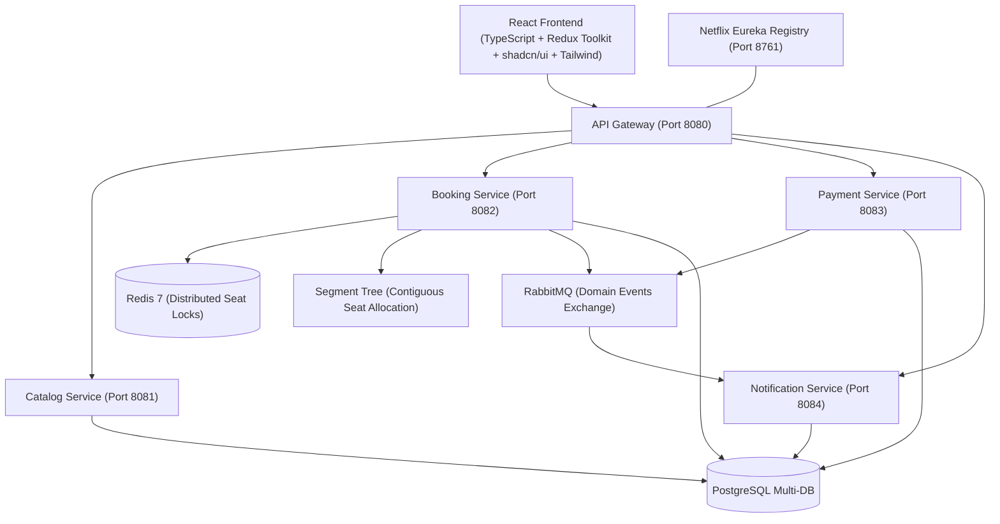

# TicketFlow — Movie & Event Booking Platform

> Inspired by **BookMyShow** & **District**, TicketFlow is a modern, full-stack, microservices-based ticket reservation platform engineered for high-throughput concurrency, distributed transaction safety, and sub-millisecond seat allocation.

---

## 🏗️ Architecture Overview



---

## 🚀 Key Engineering Concepts Implemented

### 1. Redis-Based Distributed Seat Locking
- **Problem**: In popular movie releases, hundreds of users concurrently attempt to select the same seats.
- **Solution**: Atomic distributed lock acquisition via Redis `SET key value NX PX ttl` (`lock:show:{showId}:seat:{seatId}`).
- **Features**:
  - 10-minute temporary lock TTL (`600s`).
  - Atomic multi-seat lock with automatic rollback if any individual seat lock fails (avoids partial reservations and race conditions).
  - Real-time seat status merging (DB status + Redis live locks) with countdown timer.

### 2. Segment Tree Contiguous Seat Allocation ($O(\log N)$)
- **Problem**: Groups of users want contiguous seats together in a single row without gaps. Scanning linear seat arrays repeatedly across large cinema complexes is computationally expensive.
- **Solution**: A custom `SegmentTree` class maintaining continuous intervals of available seats.
- **Properties**:
  - Builds in $O(N)$ and queries $K$ consecutive seats in $O(\log N)$.
  - Automatically handles boundary crossing between sub-segments via prefix and suffix contiguous pointers.

### 3. Saga Pattern for Distributed Transactions
- **Pattern**: Orchestrated Saga managing the distributed lifecycle across Booking and Payment services.
  1. **Lock**: Acquire temporary Redis locks on requested seats.
  2. **Pending**: Persist Booking with status `PAYMENT_PENDING`.
  3. **Payment**: Initiate payment transaction with unique `idempotencyKey`.
  4. **Commit**: On payment success $\rightarrow$ mark Booking `CONFIRMED`, mark seats `BOOKED` in Postgres, release Redis locks, publish `BookingConfirmedEvent`.
  5. **Compensate (Rollback)**: On payment failure or timeout $\rightarrow$ trigger compensating transaction: mark Booking `CANCELLED`, release Redis seat locks, publish `BookingCancelledEvent`.

### 4. Asynchronous Event-Driven Notifications (RabbitMQ)
- **Exchange**: `ticketflow.topic.exchange`
- **Topics**: `booking.*`, `payment.*`
- Decouples notification dispatch (e-mail digital tickets, SMS, push) from synchronous booking latency.

---

## 📁 Repository Structure

```
TicketFlow/
├── backend/
│   ├── pom.xml                               # Parent Maven POM
│   ├── shared-dto/                           # Common DTOs, Enums & RabbitMQ Domain Events
│   ├── service-registry/                     # Eureka Service Discovery (Port 8761)
│   ├── api-gateway/                          # Spring Cloud Gateway & CORS (Port 8080)
│   ├── catalog-service/                      # Movies, Events, Theatres, Shows (Port 8081)
│   ├── booking-service/                      # Redis Lock, Segment Tree, Saga (Port 8082)
│   ├── payment-service/                      # Payment Gateway & Compensation (Port 8083)
│   └── notification-service/                 # RabbitMQ Consumer & E-Tickets (Port 8084)
├── frontend/                                 # React + TypeScript + Redux Toolkit + shadcn/ui
│   ├── src/
│   │   ├── api/client.ts                     # Typed API Gateway client with mock fallback
│   │   ├── components/
│   │   │   ├── ui/                           # shadcn/ui Primitives (button, badge, card, dialog, separator)
│   │   │   ├── Navbar.tsx                    # Header, City selector & My Tickets
│   │   │   ├── SeatMap.tsx                   # Interactive cinema layout with screen glow
│   │   │   ├── ContiguousSeatPicker.tsx      # Segment Tree UI allocator
│   │   │   ├── LockCountdownTimer.tsx        # 10-minute Redis lock countdown
│   │   │   ├── CheckoutModal.tsx             # Saga payment modal with rollback test
│   │   │   ├── TicketConfirmation.tsx        # Confetti & digital e-ticket view
│   │   │   ├── HomePage.tsx                  # Trending movies & live events
│   │   │   ├── MovieDetailPage.tsx           # Movie info, trailer & showtimes
│   │   │   ├── SeatBookingPage.tsx           # Cinema hall view & seat selection
│   │   │   └── MyBookingsPage.tsx            # User booking history & tickets
│   │   ├── store/                            # Redux Toolkit Store
│   │   │   ├── index.ts                      # Store configuration, RootState, AppDispatch
│   │   │   ├── hooks.ts                      # Typed useAppDispatch & useAppSelector
│   │   │   └── slices/                       # citySlice, bookingSlice, catalogSlice
│   │   ├── types/                            # TypeScript interfaces & models
│   │   │   └── models.ts                     # Movie, Show, Seat, Booking, SagaStep
│   │   ├── lib/utils.ts                      # shadcn cn() class merger
│   │   ├── App.tsx
│   │   └── main.tsx
│   ├── tsconfig.json                         # TypeScript compiler config with @/ path aliases
│   ├── package.json
│   └── vite.config.ts
├── docker/
│   ├── docker-compose.yml                    # PostgreSQL 16, Redis 7, RabbitMQ 3 Management
│   └── postgres/init.sql                     # Multi-database isolation scripts
├── scripts/
│   ├── start-infra.bat                       # Launch Docker infrastructure
│   ├── build-all.bat                         # Maven multi-module package
│   └── run-frontend.bat                      # Launch React dev server
└── README.md
```

---

## 📡 REST API Endpoints Reference

### 🎬 Catalog Service (`/api/catalog`)
| Method | Endpoint | Description |
|---|---|---|
| `GET` | `/api/catalog/movies` | Fetch all movies |
| `GET` | `/api/catalog/movies/trending` | Fetch trending movies in region |
| `GET` | `/api/catalog/movies/{id}` | Movie details, rating, genres & trailer |
| `GET` | `/api/catalog/events` | Fetch live concerts and comedy events |
| `GET` | `/api/catalog/theatres?city={city}` | List cinema halls in city |
| `GET` | `/api/catalog/shows?movieId={id}&city={city}` | Available showtimes for a movie |

### 🎟️ Booking Service (`/api/bookings`)
| Method | Endpoint | Description |
|---|---|---|
| `GET` | `/api/bookings/shows/{showId}/seats` | Real-time seat matrix with live Redis locks |
| `POST` | `/api/bookings/lock-seats` | Acquire atomic Redis distributed lock (TTL: 10m) |
| `POST` | `/api/bookings/unlock-seats` | Explicit release of temporary seat lock |
| `POST` | `/api/bookings/auto-allocate` | **Segment Tree contiguous $K$ seat allocation** |
| `POST` | `/api/bookings/initiate` | Start Saga booking transaction (`PAYMENT_PENDING`) |
| `POST` | `/api/bookings/{id}/confirm` | Confirm booking & mark seats `BOOKED` |
| `POST` | `/api/bookings/{id}/cancel` | Saga compensating rollback |
| `GET` | `/api/bookings/user/{userId}` | List user's booking history |

### 💳 Payment Service (`/api/payments`)
| Method | Endpoint | Description |
|---|---|---|
| `POST` | `/api/payments/process` | Process transaction with idempotency key & Saga step |
| `GET` | `/api/payments/{transactionId}` | Query payment status |
| `GET` | `/api/payments/booking/{bookingId}` | Query transaction for booking |

### 🔔 Notification Service (`/api/notifications`)
| Method | Endpoint | Description |
|---|---|---|
| `GET` | `/api/notifications/booking/{ref}` | Fetch dispatched ticket notifications & SMS |

---

## ⚡ Quick Start Guide

### 1. Start Infrastructure (Docker)
Ensure Docker Desktop is running, then execute:
```cmd
cd scripts
start-infra.bat
```
This spins up:
- **PostgreSQL 16** on `localhost:5432` with pre-created databases (`ticketflow_catalog`, `ticketflow_booking`, `ticketflow_payment`, `ticketflow_notification`)
- **Redis 7** on `localhost:6379`
- **RabbitMQ 3.13** on `localhost:5672` (Management UI: `http://localhost:15672`, credentials `guest`/`guest`)

### 2. Start Frontend
Dependencies are already installed. Run:
```cmd
cd frontend
npm run dev
```
Open **[http://localhost:3000](http://localhost:3000)** in your browser!
The frontend includes built-in mock fallback data so you can immediately experience:
- Cinema show listings and city switching
- Live Interactive Cinema Hall Seating with Platinum, Gold, and Silver tiers
- Segment Tree Contiguous Seat Selector
- 10-Minute Redis Lock Countdown Timer
- Saga Distributed Transaction Simulation (including payment failure rollback testing)
- Confetti celebration and digital e-Ticket with printable QR pass

### 3. Build & Run Backend Microservices
```cmd
cd backend
mvn clean install -DskipTests
```
Launch the services in order:
1. `service-registry` (`ServiceRegistryApplication.java`) — Port 8761
2. `api-gateway` (`ApiGatewayApplication.java`) — Port 8080
3. `catalog-service` (`CatalogServiceApplication.java`) — Port 8081
4. `booking-service` (`BookingServiceApplication.java`) — Port 8082
5. `payment-service` (`PaymentServiceApplication.java`) — Port 8083
6. `notification-service` (`NotificationServiceApplication.java`) — Port 8084

